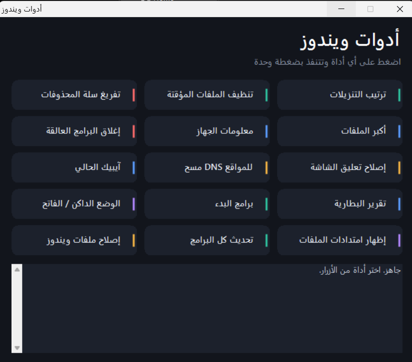

# 🛠️ Windows Tools

  <a href="https://zzaaiiddcpu.github.io/Windows-Tools/">
    🌐 Official Website
  </a>
  &nbsp; | &nbsp;
  <a href="https://github.com/zzaaiiddcpu/Windows-Tools/releases/latest">
    📥 Download
  </a>

A collection of useful Windows tools in one simple, modern application.

**Windows Tools v1.0** — Built with PowerShell and Windows Forms.

## ✨ Features

- 15 useful Windows tools.
- Simple and modern dark interface.
- Arabic user interface.
- Lightweight and easy to use.
- Designed for Windows 10 and Windows 11.

## 📥 Download

**[Download Windows Tools v1.0](https://github.com/zzaaiiddcpu/Windows-Tools/releases/latest)**

## 🚀 How to Run

1. Download the application from Releases.
2. Extract the downloaded file if it is inside a ZIP archive.
3. Run `WindowsTools_v4.exe`.

## 🧰 Built With

- PowerShell
- Windows Forms
- PS2EXE

## 🌐 Official Website

[Visit Windows Tools Website](https://zzaaiiddcpu.github.io/Windows-Tools/)

## 👨‍💻 Developer

Created by **Zaid Ma'aitah**.

---

## © Copyright

Copyright © 2026 Zaid Ma'aitah. All Rights Reserved.

Windows Tools is proprietary software.

No copying, modification, redistribution, republishing, or commercial use is permitted without prior written permission from the copyright owner, except where applicable law provides otherwise.

For permissions and licensing inquiries, please contact the copyright owner.

---

**Thank you for visiting Windows Tools!** ⭐
